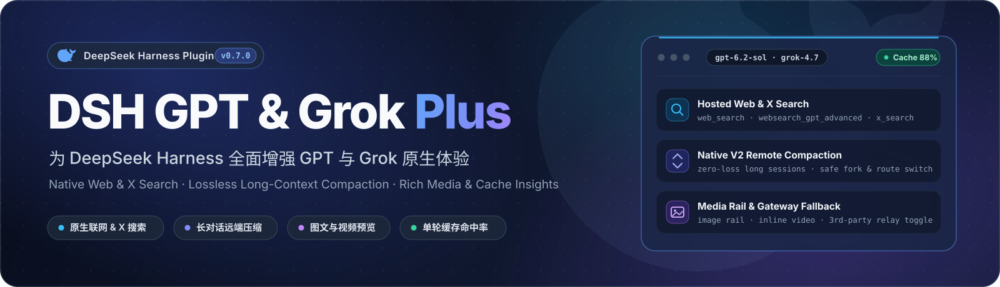
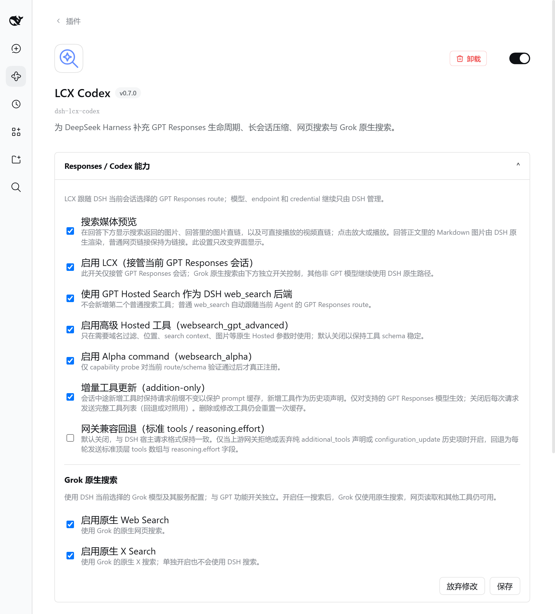

<div align="center">



# LCX — DeepSeek Harness 的 GPT & Grok 增强插件

**让 [DeepSeek Harness](https://github.com/deepseek-ai/DeepSeek-Harness) 原生用好 GPT 与 Grok：实时联网 / X 搜索、超长对话自动压缩、图文视频预览与缓存命中率显示。**

[](https://www.npmjs.com/package/dsh-lcx-codex)
[](#安装与版本选择)
[](LICENSE)

**简体中文** · [English](README_EN.md) · [更新日志](CHANGELOG.md) · [问题反馈](https://github.com/kk3ya03-star/dsh-lcx-codex/issues)

</div>

[DeepSeek Harness (DSH)](https://github.com/deepseek-ai/DeepSeek-Harness) 本身已经帮你管好了模型配置、API 密钥、会话与工具体系，但在对接 **GPT（OpenAI Responses）** 与 **Grok（xAI Responses）** 时，还缺少服务端联网搜索、超长上下文远端无损压缩以及搜索富媒体呈现等能力。

**LCX** 就是为补齐这些能力而生的轻量插件：它**不改变你在 DSH 中的任何原有配置、不接管 DeepSeek 等其他模型**，只在你启用后为 GPT 与 Grok 对话打开更顺手的工具链与长对话体验。（npm 包名保持 `dsh-lcx-codex`，确保已有用户可直接无感升级。）

---

## 能帮你做到什么？

| 功能 | 实际体验 |
| --- | --- |
| **GPT 原生联网搜索** | 让 GPT 直接通过 DSH 标准的 `web_search` 入口查资料并给出带来源引用的回答。 |
| **GPT 高级搜索与过滤** | 额外提供图片搜索、指定域名范围、地区定位等精确检索控制。 |
| **Grok 原生网页与 X 搜索** | 直连 xAI Responses 服务端 **Web Search** 与 **X Search**，同时保留本地读文件 / MCP 等工具。 |
| **超长对话远端压缩（Native V2）** | 长任务接近上下文上限时，支持兼容的 GPT 路线在服务端自动压缩并续跑，不断档、不丢线索。 |
| **搜索图文与视频预览** | 在回答下方自动整理搜索返回图片横排墙（支持点击放大预览）与可点击行内播放的视频卡片。 |
| **单轮缓存命中率显示** | 当上游返回缓存计数时，在每轮回答末尾展示只读的 `缓存命中 XX%` 胶囊，一眼看清前缀缓存效果。 |
| **第三方中转网关兼容开关** | 新增可选的 **「网关兼容回退」** 开关，适配不支持 `additional_tools` / `configuration_update` 的第三方中转站。 |

---

## 安装与版本选择

安装 DSH 当前稳定版对应的最新插件（`dsh-lcx-codex@0.7.0`）：

```sh
dsh plugin --profile web add dsh-lcx-codex@latest
dsh web
```

> 装好后，进入 DSH Web 左侧 **插件 → LCX Codex** 即可一键开启需要的功能。

请按你本地使用的 **DSH 版本** 选择对应插件版本：

| 你正在使用的 DSH 版本 | 对应插件安装命令 | 说明 |
| --- | --- | --- |
| **DSH `0.2.2`**（推荐，基线 `0.2.2-rc.5`，Pi `1.6.0`） | `dsh plugin --profile web add dsh-lcx-codex@latest` | **`0.7.0`（当前 `@latest`）**，支持 GPT-6.2 / Grok 4.6-4.7、缓存命中胶囊与网关回退开关 |
| DSH `0.2.1`（基线 `0.2.1-rc.5`，Pi `1.5.0`） | `dsh plugin --profile web add dsh-lcx-codex@0.6.0` | 旧稳定版 `0.6.0`（维护分支 `stable/0.6.x`） |
| DSH `0.2.0`（基线 `0.2.0-rc.2`，Pi `0.87.1`） | `dsh plugin --profile web add dsh-lcx-codex@0.5.2` | 历史版本 `0.5.2`（维护分支 `stable/0.5.x`） |
| DSH `0.1.5`（基线 `0.1.5-rc.1`，Pi `0.85.1`） | `dsh plugin --profile web add dsh-lcx-codex@0.4.3` | 历史固定版本 `0.4.3` |

运行环境要求：Node.js `^22.19.0 || >=24.0.0`。

---

## 三步开启推荐配置

打开 DSH Web → 左侧边栏 **「插件」** → 点击 **「LCX Codex」** → 展开 **「Responses / Codex 能力」**：

<div align="center">



</div>

1. **开启 GPT 核心能力**：打开 **启用 LCX** 与 **使用 GPT Hosted Search**（需要图搜/按域名检索时再打开 **启用 GPT 高级搜索工具**；**增量工具更新** 建议保持默认开启以保护前缀缓存）。
2. **开启 Grok 原生搜索**（独立于 GPT 开关）：按需勾选 **Grok 原生联网搜索** 与 **Grok 原生 X 搜索**。
3. **开启视觉增强与按需适配网关**：建议开启 **搜索媒体预览**；如果你使用的是 **第三方 OpenAI 中转站** 且遇到丢工具或报错，再勾选 **网关兼容回退（标准 tools / reasoning.effort）**（官转 / 官方渠道保持关闭即可）。

---

## 日常怎么用？

配置完后直接用自然语言对话即可，无需手动写任何工具参数：

> 帮我查一下 Python 3.13 里 `asyncio.TaskGroup` 的异常处理注意事项，并附上官方文档依据。

> 搜几张秋天的富士山高清图片展示在回答里，顺便给出图片来源页面。

> 用 Grok 在 X 上搜一下大家最近对这个项目的讨论要点。

做超长代码库排查或连续任务时也不用盯着上下文条：兼容的 GPT 路线会自动在临界点触发远端无损压缩，也可以随时输入 `/compact` 手动压缩。

---

## 常见问题排查

- **装完插件好像没变化？**
  请确认 `dsh plugin add` 和 `dsh web` 使用的是同一个 profile（比如都是 `--profile web`），打开插件开关并点击保存后，如页面早已开着请刷新一次浏览器标签页。
- **切换到 Grok 时报错 `MODEL_SWITCH_COMPACTION_FAILED`？**
  DSH `0.2.2` 会拒绝 `maxTokens >= contextWindow` 的模型配置。请在你的 `llm-pi-ai` Grok 提供商配置里把 `maxTokens` 调到明显小于 `contextWindow`（例如窗口 `500000` 时把 `maxTokens` 设为 `64000` 或 `128000`）。
- **接入第三方中转网关后，GPT-6 对话报 `configuration_update` / `additional_tools` 错误或调用不到工具？**
  部分第三方网关尚不支持 OpenAI 最新的增量包结构。请在插件设置里勾选 **「网关兼容回退（标准 tools / reasoning.effort）」**，保存后在新一轮对话重试即可。
- **Grok 原生搜索支持哪些认证方式？**
  支持 API Key 与兼容的 API 网关；xAI 浏览器 OAuth / SuperGrok 账号登录暂不在支持范围内。Alpha 网页深读目前仍属实验性能力，部分站点可能受上游限制。

遇到 bug 请前往 [Issues](https://github.com/kk3ya03-star/dsh-lcx-codex/issues) 提交，附上 **插件版本、DSH 版本、Node.js 版本与复现步骤** 即可（请勿粘贴 API Key 或完整原始日志）。

---

## 更多资料与许可

- [更新日志 (CHANGELOG)](CHANGELOG.md) · [技术架构说明 (ARCHITECTURE)](ARCHITECTURE.md) · [第三方许可声明](THIRD_PARTY_NOTICES.md)
- 基于 [MIT 协议](LICENSE) 开源。本项目为独立社区插件，与 OpenAI、xAI、DeepSeek 无隶属或背书关系。
