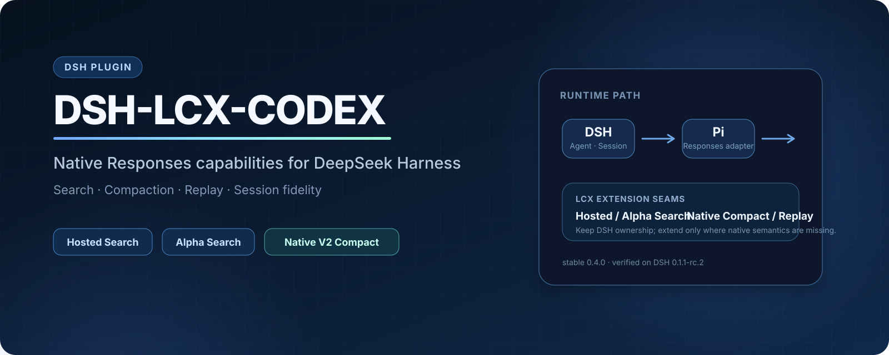
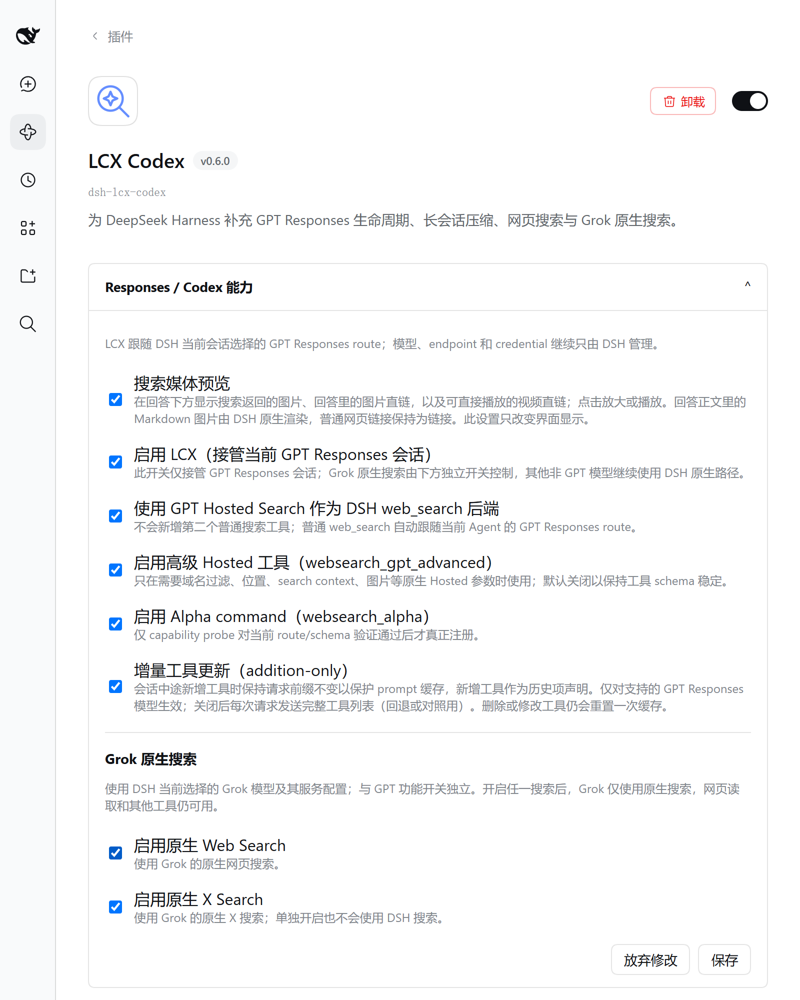

<div align="center">



# LCX Codex

**给 DeepSeek Harness 里的 GPT 和 Grok 加上联网搜索和长对话自动压缩。**

[](https://www.npmjs.com/package/dsh-lcx-codex)
[](https://www.npmjs.com/package/dsh-lcx-codex?activeTab=versions)
[](https://github.com/kk3ya03-star/dsh-lcx-codex/blob/main/LICENSE)

**简体中文** · [English](https://github.com/kk3ya03-star/dsh-lcx-codex/blob/main/README_EN.md) · [更新日志](https://github.com/kk3ya03-star/dsh-lcx-codex/blob/main/CHANGELOG.md) · [问题反馈](https://github.com/kk3ya03-star/dsh-lcx-codex/issues)

</div>

LCX Codex 是 [DeepSeek Harness](https://github.com/deepseek-ai/DeepSeek-Harness)（DSH）的社区插件。装上之后，你在 DSH 里用的 GPT 和 Grok 可以：

- **联网搜索**：GPT 使用 Responses 服务端搜索（Hosted Search），Grok 使用 xAI 原生 Web Search 和 X Search；
- **长任务不中断**：对话接近上下文上限时自动压缩并继续，不用手动开新会话；
- **直接看到图片和视频**：搜索返回的图片、回答里的图片直链排成一行显示在回答下方，点击用 DSH 自带的看图器放大；视频直链显示为卡片，点击后在回答里直接播放。

模型、API Key、会话和其他工具仍由 DSH 管理，不需要额外配置。其他模型（如 DeepSeek）照常走 DSH 自己的逻辑，不受影响。

## 使用前提

- 已安装 DSH，并在 DSH 中配置好 **GPT 或 Grok 的 Responses API 路由**（官方 API 或兼容网关均可）。
- Node.js `^22.19.0` 或 `>=24.0.0`。

> 搜索和压缩依赖服务端能力。你的网关能正常聊天，不代表它一定支持这些功能，详见[已知限制](#已知限制)。

## 安装

### 1. 按 DSH 版本选择插件版本

先运行 `dsh --version` 查看 DSH 版本，再按下表选择：

| 你的 DSH 版本 | 安装的 LCX 版本 | 安装命令中的标签 |
| --- | --- | --- |
| `0.2.2-alpha.3` 及以后（DSH `0.2.2` 预发布系列） | `0.7.0-pre.1`（预发布版） | `@prelatest` |
| `0.2.1` 系列（`0.2.1-rc.5` 及以后的 `0.2.1` 版本，DSH `latest` 通道） | `0.6.0`（稳定版） | `@latest` |
| `0.2.0` 系列（`0.2.0-rc.2`，早于 `0.2.1-alpha.2`） | `0.5.2`（旧稳定版） | `@0.5.2` |
| `0.1.6` 系列（`0.1.6-alpha.2` 及以后） | `0.4.4-pre.1`（旧预发布版） | `@0.4.4-pre.1` |
| `0.1.5` 系列（`0.1.5-rc.1` 及以后） | `0.4.3`（稳定版） | `@0.4.3` |

请务必按表格选择：几个版本互不兼容，装错版本时安装命令可能只给出依赖警告，但插件可能无法正常工作。`@latest` 是稳定版 `0.6.0`（发布基线 DSH `0.2.1-rc.5`，host / plugin Pi `1.5.0`）；DSH `0.2.0` 用户请固定安装 `@0.5.2`，DSH `0.1.5` 用户请固定安装 `@0.4.3`。历史说明：`0.6.0-pre.2` 是面向 DSH `0.2.1-alpha.2` 的历史预发布版，只在 DSH `0.2.1-alpha.2` 上验证过；`0.2.1-rc.5` 之前的其他早期 `0.2.1` 构建都没有经过验证。使用早期 `0.2.1` 构建时，请把 DSH 升级到 `0.2.1-rc.5`，再安装 `0.6.0`（`@latest`）。DSH `0.2.2-alpha.1` / `0.2.2-alpha.2` 没有经过验证的 LCX 版本，请升级到 `0.2.2-alpha.3` 或更新版本。

稳定版 `0.6.0` 的安装范围是 `>=0.2.1-rc.5 <0.2.2-0`：之后的 DSH `0.2.1` 版本也能装上，但**没有经过验证**；上限写成 `<0.2.2-0` 是为了不放行 DSH `0.2.2` 的预发布版。本版本的验证基线只有 DSH `0.2.1-rc.5`（host Pi `1.5.0`，plugin Pi `1.5.0`）。

`0.7.0-pre.1` 是预发布版，面向 DSH `0.2.2` 预发布系列（从 `0.2.2-alpha.3` 起）。它的安装范围**只有下限**（`>=0.2.2-alpha.3`），没有上限：更新的 DSH 版本也能装上，但**没有经过验证**。本次预发布的验证基线只有 DSH `0.2.2-alpha.3`（host Pi `1.5.0`，plugin Pi `1.5.0`），请不要据此认为其他 DSH 版本受支持。

`0.6.0` 和 `0.7.0-pre.1` 的主要变化（详见[更新日志](https://github.com/kk3ya03-star/dsh-lcx-codex/blob/main/CHANGELOG.md)）：

- **内置 Pi 跟随 DSH 升级到 `1.5.0`**：GPT-5.6 / GPT-6 系列模型的工具声明与 DSH 自己的发送方式一致（全部以 `additional_tools` 形式声明，不再发送顶层 `tools`），会话中途新增或删除工具、重启、分叉和压缩之后也保持一致。
- **切换推理强度不再让缓存失效**：在 `openai` 的 GPT-6 系列模型上，会话中途切换推理强度会保留已缓存的前缀，与 DSH 自己的处理一致。
- **自动审查修复**：GPT 路由上 DSH 自动审查（auto-review）的请求现在会带上它自己的系统提示词，不再以 `AUTO_REVIEW_FAILED` 失败。
- **仅 `0.7.0-pre.1`**：适配 DSH `0.2.2` 的插件接口；LCX 发出的 GPT 请求也会应用其他插件通过 `llm-pi-ai/request-headers` 提供的请求头，但这些插件不能替换凭据、会话亲和和请求关联相关的请求头。

从 `0.6.0-pre` 系列开始适配的 DSH `0.2.1` 插件新能力（`0.6.0` 和 `0.7.0-pre.1` 都包含）：

- **增量工具更新（只增不改）**：在 DSH 声明支持该模式的 GPT Responses 路由上，会话中途新增工具（例如打开联网搜索、启用 MCP 或技能）时，请求里的工具列表保持不变，新增的工具以历史项的形式声明，因此不再改变已缓存的前缀。设置卡片里有“增量工具更新”开关，默认开启，关闭后每次请求都发送完整的当前工具列表。删除工具或同名重定义仍会让缓存失效一次。Grok、自定义命名路由、分叉与路由迁移的回放、压缩检查点仍然发送完整工具列表。
- **程序化工具调用里的搜索**：在 `run_code` 程序里调用 `web_search` / `websearch_gpt_advanced` 时，搜索用量和返回的图片也会计入并显示。
- **插件管理页卡片**：LCX 在插件管理页显示自己的名称（LCX Codex）、简介和图标。

> 注意：旧稳定版 `0.5.x` 的安装范围写作 `>=0.2.0-rc.2 <0.2.1`，按 DSH 的版本范围规则，`0.2.1` 的预发布版（如 `0.2.1-rc.5`）也可能被放行安装，但这些版本**不在** `0.5.x` 的支持和验证范围内；DSH `0.2.1-rc.5` 及以后的 `0.2.1` 版本请使用 `@latest`（`0.6.0`），DSH `0.2.2-alpha.3` 及以后请使用 `@prelatest`。

### 2. 安装并启动

DSH `0.2.2-alpha.3` 及以后（预发布版）：

```sh
dsh plugin --profile web add dsh-lcx-codex@prelatest
dsh web
```

DSH `0.2.1` 系列（`0.2.1-rc.5` 及以后，稳定版；更早的 `0.2.1` 构建请先把 DSH 升级到 `0.2.1-rc.5`）：

```sh
dsh plugin --profile web add dsh-lcx-codex@latest
dsh web
```

DSH `0.2.0` 系列（注意固定版本号，不要用 `@latest`）：

```sh
dsh plugin --profile web add dsh-lcx-codex@0.5.2
dsh web
```

DSH `0.1.6` 系列：

```sh
dsh plugin --profile web add dsh-lcx-codex@0.4.4-pre.1
dsh web
```

DSH `0.1.5` 系列（注意固定版本号，不要用 `@latest`）：

```sh
dsh plugin --profile web add dsh-lcx-codex@0.4.3
dsh web
```

以后更新插件，重新运行同一条 `add` 命令即可。

### 3. 打开功能开关

打开 DSH Web 的插件页面，在 LCX 的配置卡片 **Responses / Codex 能力** 中按需打开下列开关，然后点击 **保存**。



**GPT**

| 开关 | 作用 | 建议 |
| --- | --- | --- |
| **启用 LCX** | GPT 功能的总开关，包括长对话自动压缩 | 用 GPT 时打开 |
| **使用 GPT Hosted Search 作为 DSH web_search 后端** | GPT 联网搜索 | 需要联网时打开 |
| **启用高级 Hosted 工具** | 图片搜索、限定网站、指定位置等（需先打开上一项） | 按需 |
| **启用 Alpha command** | 实验功能：让 GPT 继续打开、查找搜索结果中的页面 | 日常不需要 |
| **增量工具更新（addition-only）** | 会话中途新增工具时保持请求前缀不变以保护缓存，仅对 DSH 声明支持的 GPT 路由生效；关闭后每次请求都发送完整工具列表 | 默认开启，一般不用改 |

**Grok 原生搜索**（与“启用 LCX”相互独立）

| 开关 | 作用 |
| --- | --- |
| **启用原生 Web Search** | Grok 搜索网页 |
| **启用原生 X Search** | Grok 搜索 X 内容 |

开启任一项后，Grok 改用 xAI 原生搜索；网页读取和其他 DSH / MCP 工具仍可正常使用。

**显示**

| 开关 | 作用 |
| --- | --- |
| **搜索媒体预览** | 在回答下方显示搜索返回的图片、回答里的图片直链和可直接播放的视频直链；图片横排显示、点击放大，视频点击后在回答里播放。回答里用 Markdown 写的图片由 DSH 原生显示，不会重复；普通网页链接保持为链接。只改变界面显示，不影响发给模型的内容 |

## 怎么用

像平时一样和模型说话即可，不需要写任何工具参数：

> 搜索 Python 官方文档，告诉我 `asyncio.TaskGroup` 应该怎么用。

> 搜几张金门大桥的照片，显示一张，并附上来源网页。

> 用 Grok 看看 X 上最近关于这个项目的讨论。

长对话会在接近上限时自动压缩；你也可以随时输入 `/compact` 手动压缩。

## 从旧版本升级

- **DSH 升级到 `0.2.2-alpha.3` 或更新版本（DSH `0.2.2` 预发布系列）**：把插件换成 `@prelatest`（`0.7.0-pre.1`），`0.6.x` 没有在这些 DSH 版本上验证。
- **DSH 升级到 `0.2.1-rc.5`（DSH `latest` 通道）**：把插件换成 `@latest`（`0.6.0`）；已装 `0.6.0-pre.2` 的用户也用这条命令换到稳定版。
- **DSH `0.2.0` 系列**：继续使用 `@0.5.2`；`@latest` 现在指向支持 DSH `0.2.1` 的 `0.6.0`，旧版 `0.4.x` 不支持 DSH `0.2`。
- **DSH `0.1.6` 系列**：继续使用 `@0.4.4-pre.1`。
- **DSH `0.1.5` 系列**：继续使用 `@0.4.3`；`@latest` 现在指向支持 DSH `0.2.1` 的 `0.6.0`。
- **已装了 `0.5.0`、`0.5.1` 或 `0.5.0-pre.1`**：DSH `0.2.0` 系列运行 `@0.5.2` 的 `add` 命令即可升到 `0.5.2`（只包含缺陷修复，安装范围不变）。
- **升级后建议新建会话**：旧版本保存的压缩状态不保证兼容。DSH `0.2` 迁移过的旧长会话如果带有旧版 LCX 压缩检查点，LCX 会提示 `LCX_CHECKPOINT_UNSUPPORTED`，新建会话即可；其他模型不受影响。

## 停用与卸载

- **临时停用**：在配置卡片中关闭 **启用 LCX** 和 Grok 原生搜索开关并保存，GPT 和 Grok 即恢复 DSH 原生行为。
- **卸载**：

  ```sh
  dsh plugin --profile web remove dsh-lcx-codex
  ```

## 已知限制

- **网关能力因人而异**：搜索、压缩、Alpha 都依赖对应的服务端能力，不同网关支持程度不同。
- **Grok**：支持 API Key / API 网关路由，不支持 xAI OAuth / SuperGrok 登录。本次发布的真实运行验证了 `grok-4.6` 的原生 Web Search；原生 X Search 没有在本次发布的真实运行中单独重新验证（上一次单独验证是 `0.4.4-pre.1` 在 `grok-4.6` 上）。`grok-4.7` 在本次发布的测试网关上没有可用渠道，原生搜索没有在它上面验证。
- **Grok 的 `maxTokens` 设置（DSH `0.2.2`）**：如果 provider 配置里 Grok 模型的 `maxTokens` 等于 `contextWindow`，DSH `0.2.2` 不允许在会话中从其他模型切换到这个 Grok 模型（这是 DSH 的行为，DSH `0.2.1` 只给出警告）。请把 `maxTokens` 设得明显小于 `contextWindow`，为输入上下文和 DSH 的压缩预留留出空间；只是比 `contextWindow` 小一点，并不能保证可以切换过去。
- **Grok 长对话压力**：xAI 的智能体调用会把多次内部请求的用量累加计费。LCX 在服务端返回完整的实时上下文数据时，用它来判断何时压缩，缺失时退回估算；计费数字本身保持不变。
- **Alpha 仍是实验功能**：连续打开/查找页面在已测试的 OAuth 类上游上可用；API Key 类上游账号不在支持范围内。目标页面抓取失败时会提示 `LCX_ALPHA_PAGE_FETCH_FAILED`，模型可以换一个结果继续。
- **Markdown 图片换行**：为避免 DSH `0.2` 中图片后的文字挤到图片右侧，LCX 会让回答里的 Markdown 图片单独占一行，这一点与“搜索媒体预览”开关无关；句中的小图也会因此换行。
- **DSH `0.1.5` + LCX `0.4.3`**：在插件设置中启用或停用 LCX 后，已打开的浏览器页面可能需要刷新。
- **DSH `0.2.1` 的工具更新**：增量工具更新只在 DSH 声明“只增不改”的 GPT Responses 路由上生效；当 DSH 的工具历史或模型信息缺失、路由不支持或设置卡片里关闭了开关时，LCX 回到每次发送完整工具列表。删除工具或同名重定义仍会让缓存失效一次。缓存命中受上游影响有波动：在 `openai/gpt-6-sol` 上用同一操作序列对比，开启时新增工具后的首个请求约 80% 命中缓存，关闭时为 0%。LCX 内置与 DSH 相同的 Pi `1.5.0` 模型目录，目录里没有的更新模型按 DSH 的声明处理。GPT-5.6 / GPT-6 系列模型的工具全部以 `additional_tools` 形式声明（与 DSH 一致），网关需要支持这种请求格式。
- **验证范围**：`0.6.0` 的验证基线只有 DSH `0.2.1-rc.5`，`0.7.0-pre.1` 的验证基线只有 DSH `0.2.2-alpha.3`（两者都是 host / plugin Pi `1.5.0`）；各自安装范围内更新的 DSH 版本未经验证。两个基线上的真实运行验证覆盖 GPT 路由（`gpt-6-sol`、`gpt-6.1-sol`）、联网搜索（含高级搜索和 `run_code` 内的搜索）、手动压缩和自然触发的压缩压力档位、重启恢复、分叉与路由迁移、推理强度切换、自动审查、搜索媒体预览、插件管理页卡片和 `grok-4.6` 原生 Web Search。以下情况没有单独的完整实机验证：`gpt-5.6-sol` 的首轮对话、`gpt-5.4` / `gpt-5.5` 这类不带推理档的模型、`gpt-6-sol` 上的推理强度切换（切换验证在 `gpt-6.1-sol` 上进行）、从 GPT 切换到非 GPT 模型时的压缩、需要生成摘要的 GPT 到 GPT 模型切换、在当前 Grok 配置下从 GPT 切换到 Grok 的实际对话，以及 Alpha 搜索。旧版本：`0.6.0-pre.2` 的验证基线为 DSH `0.2.1-alpha.2`；稳定版 `0.5.2` 的发布基线为 DSH `0.2.0-rc.2`（`0.5.0` 同）；`0.4.4-pre.1` 在 DSH `0.1.6-alpha.2` 上完整验证；`0.4.3` 的稳定发布基线是 DSH `0.1.5-rc.1`，并已另外验证 DSH `0.1.5-rc.2`。同一安装范围内其他后续版本仍需单独评估，遇到问题欢迎反馈。

## 常见问题

**装完没有变化？**
确认安装命令和启动命令用的是同一个 profile（上面的示例都是 `web`），并检查插件设置里的开关已经保存。

**能正常聊天，但搜索或压缩失败？**
大概率是当前 GPT / Grok 路由没有提供对应的服务端能力。可以换官方 API 或其他网关对比一下。

**安装时出现依赖版本警告，或插件加载失败？**
通常是 DSH 版本和插件版本不匹配，按[上面的表格](#1-按-dsh-版本选择插件版本)重新选择。

**升级到 DSH 0.2 后插件“导入失败”（failed to import）？**
从较早版本一路升级上来的配置目录里可能残留旧的依赖包。先停止 `dsh web`，把 DSH 主目录（默认 `~/.dsh`，或 `DSH_HOME` 指定的目录）下 `profiles/web/` 里的 `node_modules` 和 `pnpm-lock.yaml` 移走或删除，再按[上面的表格](#1-按-dsh-版本选择插件版本)重新运行对应的 `dsh plugin --profile web add` 命令，然后启动 `dsh web`。

**刚发布新版时 `@latest` / `@prelatest` 装到了旧版本？**
包管理器的缓存可能还没刷新，DSH 会因版本不兼容拒绝安装。稍等几分钟重试，或直接指定版本号，例如 `dsh-lcx-codex@0.6.0` 或 `dsh-lcx-codex@0.7.0-pre.1`。

## 反馈问题

请在 [Issues](https://github.com/kk3ya03-star/dsh-lcx-codex/issues) 中附上：插件版本、DSH 版本、Node.js 版本、使用的模型/网关类型和复现步骤。

**请不要上传 API Key、完整请求内容或未脱敏的会话日志。**

## 更多

- [更新日志](https://github.com/kk3ya03-star/dsh-lcx-codex/blob/main/CHANGELOG.md)
- [架构说明](https://github.com/kk3ya03-star/dsh-lcx-codex/blob/main/ARCHITECTURE.md)
- [第三方许可](https://github.com/kk3ya03-star/dsh-lcx-codex/blob/main/THIRD_PARTY_NOTICES.md)
- [参与贡献](https://github.com/kk3ya03-star/dsh-lcx-codex/blob/main/CONTRIBUTING.md)

## 许可证

[MIT](https://github.com/kk3ya03-star/dsh-lcx-codex/blob/main/LICENSE)。独立社区插件，与 OpenAI、xAI、DeepSeek、Sub2API、NewAPI 无隶属关系，也未获得其官方背书。
