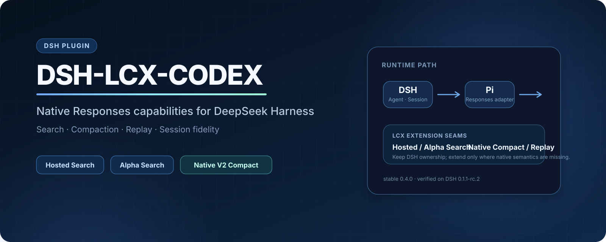

<div align="center">



# LCX Codex

**Better long-running GPT and Grok workflows, web search, and continuous work inside DeepSeek Harness.**

[](https://www.npmjs.com/package/dsh-lcx-codex)
[](https://www.npmjs.com/package/dsh-lcx-codex?activeTab=versions)
[](https://github.com/kk3ya03-star/dsh-lcx-codex/blob/main/LICENSE)

[简体中文](https://github.com/kk3ya03-star/dsh-lcx-codex/blob/main/README.md) · **English** · [Changelog](https://github.com/kk3ya03-star/dsh-lcx-codex/blob/main/CHANGELOG.md) · [Report an issue](https://github.com/kk3ya03-star/dsh-lcx-codex/issues)

</div>

LCX Codex is a community plugin for [DeepSeek Harness](https://github.com/deepseek-ai/DeepSeek-Harness) (DSH).

It does not replace DSH or require a second model/provider configuration. Models, credentials, sessions, and tools remain managed by DSH; LCX only adds optional capabilities for GPT and Grok.

## What it adds

| Capability | Best for |
| --- | --- |
| GPT web search | Let GPT search the web through DSH's normal `web_search` entrypoint. |
| GPT advanced search | Image search, domain filters, location, and other additional search controls. |
| Grok native Web / X Search | Use xAI Responses native Web Search and X Search directly. |
| Long-conversation compaction | Let compatible GPT routes compact long sessions remotely and continue working. |
| Search media previews | Show search-returned images, direct image links and playable video links from an answer below it. |
| Alpha web actions | Experimental follow-up web reading for tasks that need to open or inspect search results. |

Other models continue through their normal DSH paths.

## Installation

Run `dsh --version` first, then pick the plugin line for your DSH version. Node.js `^22.19.0 || >=24.0.0` is required.

| Your DSH version | LCX version | Install tag |
| --- | --- | --- |
| `0.2.2-alpha.3` and later (DSH `0.2.2` prerelease series) | `0.7.0-pre.1` (prerelease) | `@prelatest` |
| `0.2.1` line (`0.2.1-rc.5` and later `0.2.1` builds, DSH `latest` channel) | `0.6.0` (stable) | `@latest` |
| `0.2.0` line (`0.2.0-rc.2`, before `0.2.1-alpha.2`) | `0.5.2` (previous stable) | `@0.5.2` |
| `0.1.6` line (`0.1.6-alpha.2` and later) | `0.4.4-pre.1` (previous prerelease) | `@0.4.4-pre.1` |
| `0.1.5` line (`0.1.5-rc.1` and later) | `0.4.3` (stable) | `@0.4.3` |

The lines are not interchangeable; installing the wrong one may only print a dependency warning while the plugin fails to work. `@latest` is the stable `0.6.0` (release baseline DSH `0.2.1-rc.5`, host/plugin Pi `1.5.0`); DSH `0.2.0` users must pin `@0.5.2` and DSH `0.1.5` users must pin `@0.4.3`. History note: `0.6.0-pre.2` is the historical prerelease for DSH `0.2.1-alpha.2` and was verified on DSH `0.2.1-alpha.2` only; the other early `0.2.1` builds before `0.2.1-rc.5` were not verified. On an early `0.2.1` build, upgrade DSH to `0.2.1-rc.5` and install `0.6.0` (`@latest`). DSH `0.2.2-alpha.1` / `0.2.2-alpha.2` have no verified LCX version; upgrade to `0.2.2-alpha.3` or later.

The stable `0.6.0` install range is `>=0.2.1-rc.5 <0.2.2-0`: later DSH `0.2.1` builds can install it, but they are **unverified**; the ceiling is written `<0.2.2-0` so that DSH `0.2.2` prereleases are not admitted. Its verified baseline is exactly DSH `0.2.1-rc.5` (host Pi `1.5.0`, plugin Pi `1.5.0`).

`0.7.0-pre.1` is a prerelease for the DSH `0.2.2` prerelease series, starting at `0.2.2-alpha.3`. Its install range has a **lower bound only** (`>=0.2.2-alpha.3`) and no upper bound: newer DSH versions can install it, but they are **unverified**. The verified baseline of this prerelease is exactly DSH `0.2.2-alpha.3` (host Pi `1.5.0`, plugin Pi `1.5.0`); do not read it as support for any other DSH version.

What changes in `0.6.0` and `0.7.0-pre.1` (see the [changelog](https://github.com/kk3ya03-star/dsh-lcx-codex/blob/main/CHANGELOG.md)):

- **Bundled Pi follows DSH to `1.5.0`**: tool declarations of the GPT-5.6 / GPT-6 model families match what DSH itself sends (every tool is declared as an `additional_tools` item, with no top-level `tools`), also after tools are added or removed mid-session, after a restart, a fork or a compaction.
- **Changing the reasoning effort keeps the cache**: on the GPT-6 models on `openai`, changing the reasoning effort mid-session keeps the cached prefix, as DSH itself does.
- **Auto-review fix**: on GPT routes, DSH auto-review requests now carry their own system prompt and no longer fail with `AUTO_REVIEW_FAILED`.
- **`0.7.0-pre.1` only**: follows the DSH `0.2.2` plugin interfaces; GPT requests sent by LCX also apply request headers that other plugins contribute through `llm-pi-ai/request-headers`, but those plugins cannot replace the credential, session-affinity or request-correlation headers.

DSH `0.2.1` plugin features adopted since the `0.6.0-pre` line (included in both `0.6.0` and `0.7.0-pre.1`):

- **Incremental (addition-only) tool updates**: on GPT Responses routes where DSH declares this mode, a tool added mid-session (for example turning on web search, or enabling an MCP server or skill) no longer changes the request `tools`; the new tool is declared as a history item, so the cached prefix stays valid. The settings card has an "Incremental tool updates" switch, on by default; off sends the complete current tool list on every request. Removing a tool or redefining one under the same name still resets the cache once. Grok, custom-named routes, fork / route-migration replay and compaction checkpoints keep sending the complete list.
- **Searches made from code**: when a `run_code` program (programmatic tool calling) calls `web_search` or `websearch_gpt_advanced`, the search usage and returned images are counted and shown.
- **Plugin Manager card**: LCX shows its own name (LCX Codex), description and icon on the Plugin Manager page.

> Note: the previous stable `0.5.x` install range is `>=0.2.0-rc.2 <0.2.1`. Under DSH's version-range semantics, `0.2.1` prereleases (for example `0.2.1-rc.5`) may also be allowed to install it, but they are **not** supported or verified for `0.5.x`; use `@latest` (`0.6.0`) on DSH `0.2.1-rc.5` and later `0.2.1` builds, and `@prelatest` on DSH `0.2.2-alpha.3` and later.

DSH `0.2.2-alpha.3` and later (prerelease):

```sh
dsh plugin --profile web add dsh-lcx-codex@prelatest
dsh web
```

DSH `0.2.1` line (`0.2.1-rc.5` and later, stable):

```sh
dsh plugin --profile web add dsh-lcx-codex@latest
dsh web
```

DSH `0.2.0` line (pin the version; do not use `@latest`):

```sh
dsh plugin --profile web add dsh-lcx-codex@0.5.2
dsh web
```

DSH `0.1.5` line (stable, pin the version; do not use `@latest`):

```sh
dsh plugin --profile web add dsh-lcx-codex@0.4.3
dsh web
```

On an early DSH `0.2.1` build (before `0.2.1-rc.5`), upgrade DSH to `0.2.1-rc.5` first and use `@latest`. DSH `0.1.6` line: `dsh plugin --profile web add dsh-lcx-codex@0.4.4-pre.1`. To update later, run the same `add` command again. If you already installed `0.6.0-pre.2` and moved DSH to `0.2.1-rc.5`, the `@latest` command moves you to the stable `0.6.0`; on DSH `0.2.2-alpha.3` and later use `@prelatest`. On the DSH `0.2.0` line, `0.5.0`, `0.5.1` and `0.5.0-pre.1` move to `0.5.2` with the `@0.5.2` command.

## Enable features

Open DSH Web plugin settings and find **Responses / Codex capabilities**.

### GPT

For normal GPT use, enable:

1. **Enable LCX**
2. **GPT Hosted Search** when web access is needed

Optional features:

- **Advanced Hosted tool**: for image search, domains, location, and other advanced search controls. It requires GPT Hosted Search.
- **Alpha**: experimental follow-up web actions. It is not needed for ordinary web search.
- **Incremental tool updates**: on by default; keeps the request prefix (and the prompt cache) stable when a tool is added mid-session on supporting GPT routes. Turn it off to send the complete tool list on every request.

### Grok

Grok native search is independent of the GPT LCX switch:

- **Grok native Web Search** searches the web.
- **Grok native X Search** searches X.

When Grok native search is enabled, LCX uses xAI's server-side search while keeping page-reading and other DSH / MCP tools available.

### Search media previews

**Search media previews** can be enabled independently. They change presentation only; they do not modify model prompts, search requests, conversation history, or cache behavior.

When enabled, LCX adds one media block below each answer:

- **Image rail**: images returned by GPT search, followed by direct image links from the answer (for example `.jpg`, `.png`, `.webp`), shown as one horizontal row at their natural proportions. Hover shows the source; click opens DSH's own image viewer; extra images scroll sideways.
- **Video cards**: direct playable video links (`.mp4`, `.webm`, `.ogv`) appear as compact cards. Nothing is loaded until you click; the video then plays inline in the answer.

Images written as Markdown in the answer are rendered by DSH itself and are never shown twice. Ordinary web pages and video sites stay as links. A direct image link that cannot be loaded simply stays a link; the answer text is never changed.

LCX also makes a Markdown image in an answer start on its own line, so text or links after it are no longer placed beside it. This small layout fix applies whether or not previews are enabled.

## Examples

Use normal language; you do not need to write tool arguments yourself.

> Search the official Python documentation and explain how `asyncio.TaskGroup` should be used.

> Find a few photos of the Golden Gate Bridge, show one, and include its source page.

> With Grok, search X for recent discussion about this project.

Long tasks do not require you to watch the context window manually. With LCX enabled, compatible GPT routes can automatically compact long conversations and keep working. You can also use `/compact` manually.

## Compatibility and known limits

- Baselines: `0.6.0` is verified only on exactly DSH `0.2.1-rc.5` and `0.7.0-pre.1` only on exactly DSH `0.2.2-alpha.3` (both with host/plugin Pi `1.5.0`); newer DSH versions inside each install range install but are unverified. The real-runtime passes on those baselines cover GPT routes (`gpt-6-sol`, `gpt-6.1-sol`), web search (including advanced search and searches made inside `run_code`), manual compaction and the naturally triggered compaction pressure band, restart/resume, fork and route migration, reasoning-effort changes, auto-review, search media previews, the Plugin Manager card and `grok-4.6` native Web Search. Without separate full real-runtime evidence: the first turn on `gpt-5.6-sol`, models without reasoning levels such as `gpt-5.4` / `gpt-5.5`, reasoning-effort changes on `gpt-6-sol` (the effort check ran on `gpt-6.1-sol`), compaction when switching from GPT to a non-GPT model, a GPT-to-GPT model switch that needs a summary, an actual GPT-to-Grok turn under the tested Grok profile, and Alpha search. Earlier lines: `0.6.0-pre.2` verified on DSH `0.2.1-alpha.2`; stable `0.5.2` is based on DSH `0.2.0-rc.2` (as is `0.5.0`, runtime identical to the verified `0.5.0-pre.1`); `0.4.4-pre.1` verified on DSH `0.1.6-alpha.2`; stable `0.4.3` on DSH `0.1.5-rc.1` (also checked on `0.1.5-rc.2`). Later releases inside each install range need separate assessment.
- When upgrading, starting a new session is recommended; old saved compaction state is not guaranteed to remain compatible. On DSH `0.2`, an old long session carrying a previous LCX checkpoint reports `LCX_CHECKPOINT_UNSUPPORTED` on the LCX path; start a new session. Other routes are unaffected.
- Grok native search supports API-key / API-gateway routes. xAI OAuth / SuperGrok login is outside the current scope. The real-runtime runs of these releases verified native Web Search on `grok-4.6`; native X Search was not separately re-verified in them (it was last verified separately on `grok-4.6` with `0.4.4-pre.1`); `grok-4.7` has no channel on the test gateway of these releases, so native search was not verified on it.
- Grok `maxTokens` on DSH `0.2.2`: if a provider profile sets a Grok model's `maxTokens` equal to its `contextWindow`, DSH `0.2.2` does not let a session switch to that Grok model (DSH behaviour; DSH `0.2.1` only warns). Set `maxTokens` clearly below `contextWindow` to leave room for the input context and DSH's compaction reserve; a value that is merely smaller does not guarantee that the switch works.
- Grok agentic calls report usage that is cumulative across internal requests. When the terminal response carries complete live-context details, LCX uses them for compaction pressure and otherwise falls back to an estimate; billed usage is unchanged.
- Alpha remains experimental. Stateful `open / find` browsing works on the tested OAuth-backed upstream; API-key upstream accounts are not covered. A failed target-page fetch is reported as `LCX_ALPHA_PAGE_FETCH_FAILED` so the model can try another result.
- DSH `0.2.1` incremental tool updates apply only on GPT Responses routes where DSH declares "addition-only"; when the DSH tool history or model information is missing, the route does not support it, or the settings-card switch is off, LCX goes back to sending the complete tool list on every request. Removing or redefining a tool still resets the cache once. Cache hits are noisy upstream: in a same-sequence comparison on `openai/gpt-6-sol`, the first request after a tool addition hit about 80% of the cache with the switch on and 0% with it off. LCX bundles the same Pi `1.5.0` model catalog as DSH; newer models missing from it follow the DSH declaration. Every tool of the GPT-5.6 / GPT-6 model families is declared as an `additional_tools` item (as DSH does), so the gateway must accept that request shape.
- On DSH `0.1.5` with `0.4.3`, after enabling or disabling the plugin an already-open browser page may need to be refreshed.
- API gateways vary in capability. A working normal chat does not guarantee that search, long-conversation compaction, Alpha, or Grok native search is also supported.

## Troubleshooting

**Installed but nothing changed?** Make sure installation and startup use the same `web` profile, then confirm the relevant feature switches were saved.

**Conversation works but search or compaction fails?** Check that the selected GPT / Grok Responses route actually provides the required server-side capability. A gateway product name alone does not guarantee every feature.

**Plugin "failed to import" after upgrading to DSH 0.2?** A profile upgraded from much older versions may still contain stale packages. Stop `dsh web`, move away or delete `node_modules` and `pnpm-lock.yaml` in `profiles/web/` under your DSH home (default `~/.dsh`, or `DSH_HOME`), run the `dsh plugin --profile web add` command that matches your DSH version in the [installation table](#installation) again, then start `dsh web`.

**`@latest` / `@prelatest` installed the previous version right after a release?** The package manager's metadata cache may not have refreshed yet, and DSH rejects the incompatible version. Retry after a few minutes, or pin the exact version, for example `dsh-lcx-codex@0.6.0` or `dsh-lcx-codex@0.7.0-pre.1`.

When opening an [issue](https://github.com/kk3ya03-star/dsh-lcx-codex/issues), include plugin, DSH, and Node.js versions plus reproduction steps. Do not post API keys, full requests, or unredacted session logs.

## More information

- [Changelog](https://github.com/kk3ya03-star/dsh-lcx-codex/blob/main/CHANGELOG.md)
- [Architecture](https://github.com/kk3ya03-star/dsh-lcx-codex/blob/main/ARCHITECTURE.md)
- [Third-party notices](https://github.com/kk3ya03-star/dsh-lcx-codex/blob/main/THIRD_PARTY_NOTICES.md)
- [Contributing](https://github.com/kk3ya03-star/dsh-lcx-codex/blob/main/CONTRIBUTING.md)

## License

[MIT](https://github.com/kk3ya03-star/dsh-lcx-codex/blob/main/LICENSE). Independent community plugin, not affiliated with or endorsed by OpenAI, DeepSeek, Sub2API, or NewAPI.
