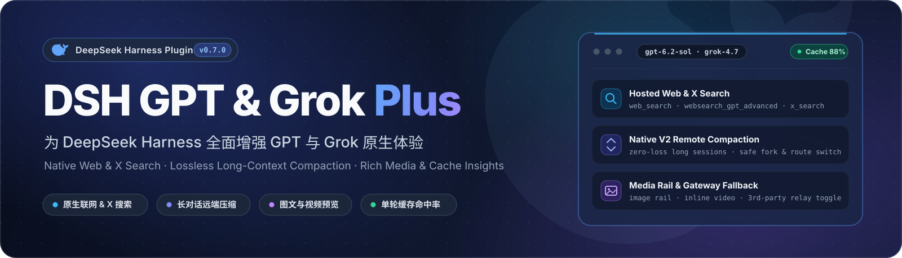
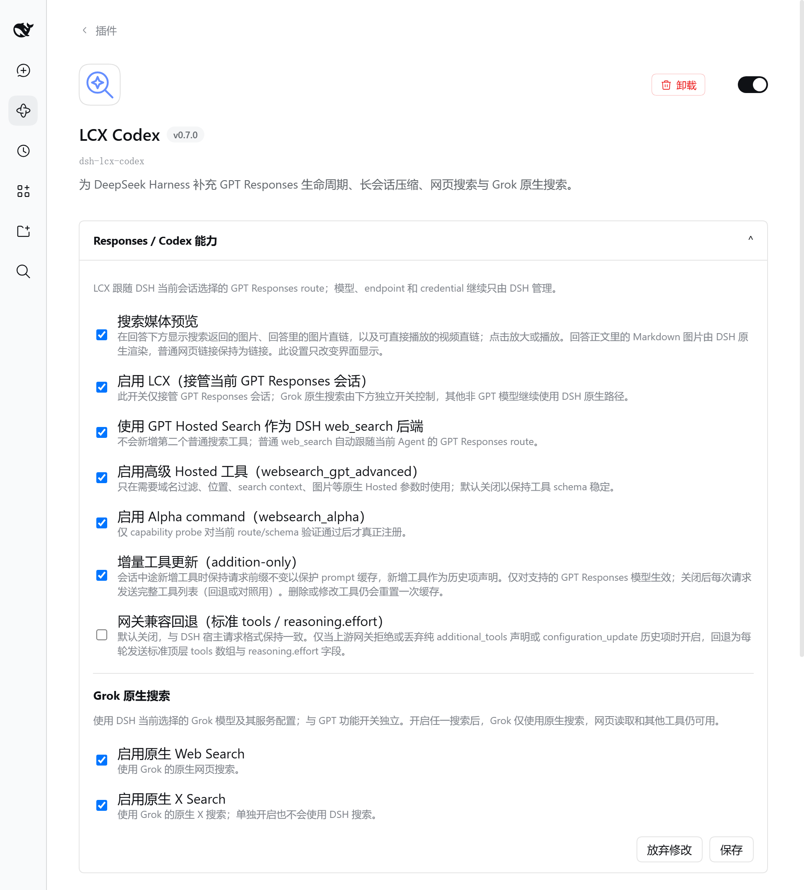

<div align="center">



# LCX — GPT & Grok Power-Up Plugin for DeepSeek Harness

**Unlock native web & X search, lossless long-context compaction, rich media previews, and per-turn cache visibility for GPT and Grok inside [DeepSeek Harness](https://github.com/deepseek-ai/DeepSeek-Harness).**

[](https://www.npmjs.com/package/dsh-lcx-codex)
[](#installation--compatibility)
[](LICENSE)

[简体中文](README.md) · **English** · [Changelog](CHANGELOG.md) · [Report an issue](https://github.com/kk3ya03-star/dsh-lcx-codex/issues)

</div>

[DeepSeek Harness (DSH)](https://github.com/deepseek-ai/DeepSeek-Harness) already manages your models, API keys, sessions, and local tools. When working with **GPT (OpenAI Responses)** and **Grok (xAI Responses)**, however, server-side web search, remote long-session compaction, and visual search previews are missing out of the box.

**LCX** fills those gaps cleanly without duplicating your setup or touching DeepSeek and other model routes. Enable it once and keep using your existing DSH profiles as usual. *(The underlying npm package stays `dsh-lcx-codex` so existing installs upgrade seamlessly via `@latest`.)*

---

## Key Capabilities

| Capability | What you get |
| --- | --- |
| **GPT Native Web Search** | Let GPT search the web directly through DSH's standard `web_search` workflow with source citations. |
| **GPT Advanced Search Controls** | Targeted image search, domain allow/deny filters, and regional search options. |
| **Grok Native Web & X Search** | Direct xAI server-side **Web Search** and **X Search** while keeping all local DSH / MCP tools active. |
| **Remote Long-Session Compaction (Native V2)** | Automatically compact long GPT sessions remotely on the provider side and keep working across turns. |
| **Search Media Previews** | Horizontal image rail (Natural proportions + lightbox preview) and click-to-play inline video cards below answers. |
| **Per-Turn Cache Hit-Rate Pill** | Compact read-only `Cache XX%` badge in the turn tail whenever provider token counters report cached input tokens. |
| **Gateway Compatibility Fallback** | Opt-in toggle to fall back to standard top-level `tools` and `reasoning.effort` for third-party relay gateways. |

---

## Installation & Compatibility

Install the current stable release (`dsh-lcx-codex@0.7.0`) for DSH `0.2.2`:

```sh
dsh plugin --profile web add dsh-lcx-codex@latest
dsh web
```

Choose the matching release tag if you run an earlier DSH line:

| DSH Version | Install Command | Notes |
| --- | --- | --- |
| **DSH `0.2.2`** (recommended, baseline `0.2.2-rc.5`, Pi `1.6.0`) | `dsh plugin --profile web add dsh-lcx-codex@latest` | **`0.7.0` (`@latest`)** — Pi `1.6.0` models, per-turn cache pill, gateway fallback toggle |
| DSH `0.2.1` (baseline `0.2.1-rc.5`, Pi `1.5.0`) | `dsh plugin --profile web add dsh-lcx-codex@0.6.0` | Previous stable line `0.6.0` (`stable/0.6.x`) |
| DSH `0.2.0` (baseline `0.2.0-rc.2`, Pi `0.87.1`) | `dsh plugin --profile web add dsh-lcx-codex@0.5.2` | Legacy stable line `0.5.2` (`stable/0.5.x`) |
| DSH `0.1.5` (baseline `0.1.5-rc.1`, Pi `0.85.1`) | `dsh plugin --profile web add dsh-lcx-codex@0.4.3` | Legacy pin `0.4.3` |

Requirement: Node.js `^22.19.0 || >=24.0.0`.

---

## Quick Setup in DSH Web

Open DSH Web → **Plugins** in the left sidebar → **LCX Codex** → expand **Responses / Codex capabilities**:

<div align="center">



</div>

1. **GPT Core Features**: Turn on **Enable LCX** and **GPT Hosted Search** (optionally add **Advanced Hosted tool** for image/domain search; keep **Incremental tool updates** on to protect your prompt cache prefix).
2. **Grok Native Search** (independent from GPT switches): Enable **Grok native Web Search** and/or **Grok native X Search** as needed.
3. **Media Previews & Third-Party Gateways**: Enable **Search media previews** for inline image/video cards; leave **Gateway compatibility fallback** **off** for standard OpenAI endpoints, and turn it **on** only if a third-party gateway drops `additional_tools` or rejects `configuration_update` items.

---

## Everyday Examples

No special tool syntax required — just ask naturally:

> Search official Python 3.13 docs for `asyncio.TaskGroup` exception handling caveats and link the source pages.

> Find a few high-resolution photos of Mount Fuji in autumn, show them below, and include their source pages.

> Use Grok to search X for recent community feedback on this topic.

During long coding sessions, compatible GPT routes compact automatically near the context limit, or you can trigger `/compact` manually anytime.

---

## Troubleshooting

- **Plugin installed, nothing changed?** Verify you installed into and launched the same DSH profile (e.g., `--profile web`), saved the switches, and refreshed any already-open browser tab.
- **Switching to Grok fails with `MODEL_SWITCH_COMPACTION_FAILED`?** DSH `0.2.2` rejects Grok profiles where `maxTokens >= contextWindow`. Set `maxTokens` clearly below `contextWindow` (for example `64000` or `128000` on a `500000` context window) in your `llm-pi-ai` provider config.
- **Third-party gateway drops tools or rejects `configuration_update`?** Turn on **Gateway compatibility fallback (standard tools / reasoning.effort)**, save, and retry on a clean turn.
- **Grok authentication scope:** Native search supports API-key and compatible gateway routes; xAI browser OAuth / SuperGrok logins are out of scope. Alpha follow-up web actions remain experimental.

When opening an [issue](https://github.com/kk3ya03-star/dsh-lcx-codex/issues), please include plugin, DSH, and Node.js versions plus reproduction steps (never share API keys or unredacted request logs).

---

## More Information & License

- [Changelog](CHANGELOG.md) · [Architecture](ARCHITECTURE.md) · [Third-party notices](THIRD_PARTY_NOTICES.md)
- Released under the [MIT License](LICENSE). Independent community plugin, not affiliated with or endorsed by OpenAI, xAI, or DeepSeek.
